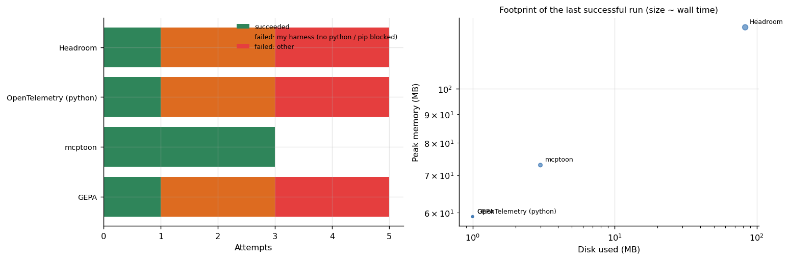

# Agent tooling: context compression and observability

**A small, honest smoke test of two tools that sit around language-model agents: a context-compression library (Headroom) and the OpenTelemetry Python SDK, plus two agent-optimization packages that were installed and run once.** This repository is mostly about what the test can and cannot claim.



## Why this matters

Context compression is sold on token savings, and tracing on negligible overhead. Both claims need a *before and after* measurement on real traffic. This lab tested the part that can be tested on a CPU sandbox, and the README says plainly where it stops, because a benchmark that overreaches is worse than none.

## What was measured

| Tool | Test | Result |
|---|---|---|
| Headroom (`headroom-ai`) | compress a synthetic 3,001-line application log in one call (import included) | **2.74 s**; 129 MB peak memory. **Token counts before and after were not recorded, so token savings were NOT measured**, and 2.7 s cannot be called negligible next to a 50 ms model call even if most of it is the library import |
| OpenTelemetry Python SDK | emit spans in a tight single-process loop | **37,939 spans per second**; 59 MB peak memory. A tight-loop ceiling, not production overhead |
| mcptoon, GEPA | installed and an example run exited with status 0 | no performance metric was recorded; **no claim is made** about either |

## What it took

4 of 4 tools ran. Of 18 attempts 6 succeeded; 6 failures were the harness (no `python` command, `pip` blocked by the system Python) and 6 were other errors. See `results/tables/failure_classes_by_tool.md`.

## What would make this a real benchmark

1. Run the compressor on real agent transcripts and count tokens before and after with the model's own tokenizer.
2. Measure end-to-end answer quality with and without compression on the same tasks.
3. Measure tracing overhead inside a running service under load, not in a loop.

## Repository map

```
src/sandbox/sandbox_suite.py   the harness (isolated HOME, time limit, peak RSS, disk, METRIC parsing)
src/tools/*.sh                 the test script of each tool above
analysis/tools_report.py       attempts, failure classes, footprints, figures
data/                          sandbox_attempts.csv, sandbox_metrics.csv
```

## Reproduce

```bash
make setup && make all
python src/sandbox/sandbox_suite.py headroom otel mcptoon gepa
```

## Articles that use this repository

- [Eighty-three open tools in a disposable sandbox](https://www.kaggle.com/code/lucasrangelss/eighty-three-open-tools-in-a-disposable-sandbox)
- Related: [web-automation-lab](https://github.com/LucasRangelSSouza/web-automation-lab), [app-platforms-smoke-tests](https://github.com/LucasRangelSSouza/app-platforms-smoke-tests)

Licence: MIT for this code; see `LICENSE_NOTES.md` (the licence of `headroom-ai` is not stated on its PyPI page).
